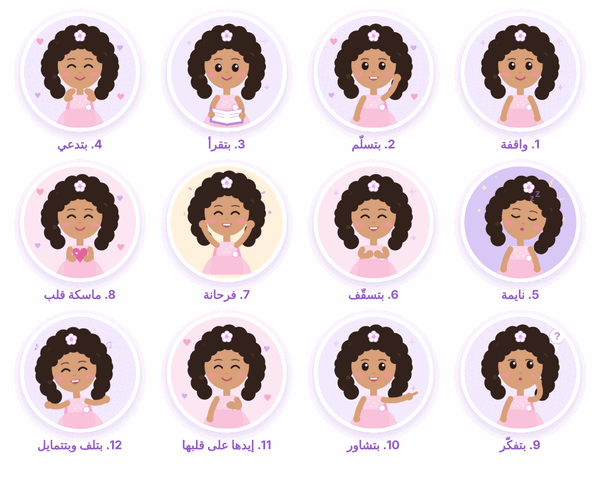

# Maryam TV — تطبيق إسلامي لتلفزيونات LG (webOS)

تطبيق webOS بسيط وخفيف يعمل على شاشات LG الذكية، يجمع القرآن الكريم مع التلاوة الصوتية، مواقيت الصلاة، الأذكار، وشاشة توقّف بآيات قرآنية — بهوية طفولية (موف فاتح، أبيض، بينك) وأفاتار مريم اللي بيتحرك ويغيّر مودها مع كل شاشة. مصمّم للتنقّل بريموت التلفزيون.

<p align="center"></p>

## المزايا

- **القرآن الكريم** — النص العثماني لكل السور مع تلاوة الشيخ مشاري العفاسي (تشغيل متتابع مع تظليل الآية الحالية).
- **مواقيت الصلاة** — للقاهرة، بطريقة الهيئة المصرية العامة للمساحة، تتحدّث تلقائيًا كل يوم مع إبراز الصلاة القادمة.
- **الأذكار** — أذكار الصباح والمساء كاملة (من حصن المسلم)، بعد الصلاة، النوم، الاستيقاظ، البيت والخروج، الطعام، دعاء لمريم، وأذكار عامة. تعمل بدون إنترنت، وبتفتح تلقائيًا على أذكار الصباح أو المساء حسب الوقت.
- **أفاتار مريم** — رسمة SVG متحركة (بترمش، بتتهز، بتسلّم) ومودها بيتغيّر حسب الشاشة:

| الشاشة | المود |
|--------|-------|
| الرئيسية | بتسلّم وبتضحك 👋 |
| القرآن | ماسكة المصحف وبتقرأ 📖 |
| مواقيت الصلاة | رافعة إيديها بالدعاء 🤲 |
| أذكار الصباح | دعاء مع شمس ☀️ |
| أذكار المساء | دعاء مع قمر ونجوم 🌙 |
| أذكار النوم / شاشة التوقف | نايمة وZzz 😴 |
| أذكار عامة / البيت | إيدها على قلبها 💜 |
| الطعام | ماسكة قلب 💗 |
| دعاء لمريم | بتسقّف 👏 |
- **شاشة التوقّف** — آيات قصيرة تتبدّل تلقائيًا مع صور شخصية، وتبدأ وحدها بعد دقيقتين من الخمول.

## حركات أفاتار مريم (12 حركة)

<p align="center"></p>

| # | الحركة | الاسم في الكود | ملف SVG |
|---|--------|----------------|---------|
| 1 | واقفة | `stand` | [01-stand.svg](assets/avatar/01-stand.svg) |
| 2 | بتسلّم (إيدها بتتهز) | `wave` | [02-wave.svg](assets/avatar/02-wave.svg) |
| 3 | بتقرأ في المصحف | `read` | [03-read.svg](assets/avatar/03-read.svg) |
| 4 | بتدعي | `dua` | [04-dua.svg](assets/avatar/04-dua.svg) |
| 5 | نايمة + Zzz | `sleep` | [05-sleep.svg](assets/avatar/05-sleep.svg) |
| 6 | بتسقّف | `clap` | [06-clap.svg](assets/avatar/06-clap.svg) |
| 7 | فرحانة وبتنط + قصاقيص | `cheer` | [07-cheer.svg](assets/avatar/07-cheer.svg) |
| 8 | ماسكة قلب بينبض | `love` | [08-love.svg](assets/avatar/08-love.svg) |
| 9 | بتفكّر + فقاعة ؟ | `think` | [09-think.svg](assets/avatar/09-think.svg) |
| 10 | بتشاور | `point` | [10-point.svg](assets/avatar/10-point.svg) |
| 11 | إيدها على قلبها | `salam` | [11-salam.svg](assets/avatar/11-salam.svg) |
| 12 | بتلف وبتتمايل + نوتات | `twirl` | [12-twirl.svg](assets/avatar/12-twirl.svg) |

> ملفات الـ SVG في `assets/avatar/` صور ثابتة للمعاينة؛ الحركة نفسها (الرمش، التسقيف، النط…) بتشتغل جوه التطبيق من CSS في `css/style.css`.

**الاستخدام في الكود:**

```js
Avatar.setMood('cheer');   // أي حركة من الـ 12
```

```html
<!-- أفاتار بيتبع مود الشاشة -->
<div data-avatar></div>
<!-- أفاتار ثابت على حركة معيّنة -->
<div data-avatar data-avatar-fixed="love"></div>
```

مودات الشاشات مبنية على الحركات: `home`→بتسلّم، `quran`→بتقرأ، `prayer`→بتدعي، `morning`/`evening`→بتدعي مع شمس/قمر، `dhikr`→إيدها على قلبها، `food`→ماسكة قلب، `kids`→بتسقّف.

## التنقّل بالريموت

| الزر | الوظيفة |
|------|---------|
| الأسهم | التنقّل بين العناصر |
| OK / Enter | اختيار |
| Back | رجوع |

## الهيكل

```
mayam-tv/
├── appinfo.json        # بيانات تطبيق webOS
├── index.html          # الواجهة والشاشات
├── icon.png            # أيقونة 80×80 (الأفاتار)
├── largeIcon.png       # أيقونة 130×130
├── assets/
│   ├── maryam-avatar.svg   # الأفاتار (مصدر الأيقونات)
│   └── avatar/             # الـ 12 حركة SVG + معاينة poses.png/gif
├── css/style.css       # التنسيقات (RTL، مهيّأة لشاشة 1920×1080)
└── js/
    ├── nav.js          # تنقّل D-pad بالريموت
    ├── app.js          # الراوتر + الساعة + التهيئة
    ├── prayer.js       # مواقيت الصلاة (Aladhan API)
    ├── quran.js        # القرآن نصًّا وصوتًا (AlQuran Cloud API)
    ├── adhkar.js       # عرض الأذكار
    ├── adhkar-data.js  # بيانات الأذكار (كل تبويب ليه mood)
    ├── avatar.js       # رسمة أفاتار مريم + الـ moods
    ├── data-ayat.js    # آيات شاشة التوقّف + قائمة الصور
    └── screensaver.js  # منطق شاشة التوقّف
```

## الإضافة والتعديل

- **صور شاشة التوقّف:** ضع الصور داخل `assets/photos/` ثم أضف مساراتها في مصفوفة `PHOTOS` بملف `js/data-ayat.js`. ⚠️ الريبو عام (public)، فمتعملش commit للصور الشخصية — خلّيها على جهازك بس قبل `ares-package` (المجلد `assets/photos/` متضاف في `.gitignore`).
- **المدينة:** عدّل `LAT` و `LNG` في `js/prayer.js`.
- **شكل الأفاتار:** الألوان (شعر، بشرة، فستان، توكة) في `LOOK` أول ملف `js/avatar.js`. بعد أي تعديل أعد توليد الأيقونات:
  ```bash
  node -e 'require("./js/avatar.js");require("fs").writeFileSync("assets/maryam-avatar.svg",Avatar.svg("home"))'
  rsvg-convert -w 80 -h 80 assets/maryam-avatar.svg -o icon.png
  rsvg-convert -w 130 -h 130 assets/maryam-avatar.svg -o largeIcon.png
  ```
- **الأذكار:** أضف تبويب جديد في `js/adhkar-data.js` بالشكل `{ name, icon, mood, items:[{text, count, note?}] }`.
- **التلاوة:** عدّل نسخة القارئ في رابط الـ API بملف `js/quran.js` (مثل `ar.alafasy`).

## التثبيت على الشاشة (وضع المطوّر)

1. فعّل **Developer Mode** على التلفزيون (يتطلب حساب LG Developer مجاني).
2. ثبّت أدوات التطوير:
   ```bash
   npm install -g @webosose/ares-cli
   ```
3. أضف الشاشة كجهاز هدف باستخدام الـ IP والـ passphrase من تطبيق Developer Mode:
   ```bash
   ares-setup-device
   ```
4. حزّم التطبيق وثبّته:
   ```bash
   ares-package .
   ares-install ./com.abdelkarim.maryamtv_1.1.0_all.ipk -d <اسم-الجهاز>
   ```

## البيانات الخارجية

- مواقيت الصلاة: [Aladhan API](https://aladhan.com/prayer-times-api)
- نص القرآن والتلاوة: [AlQuran Cloud API](https://alquran.cloud/api)

يحتاج التطبيق اتصال إنترنت على الشاشة لتحميل القرآن والمواقيت؛ الأذكار والأفاتار وشاشة التوقّف تعمل بدون إنترنت.

## الرخصة

MIT
